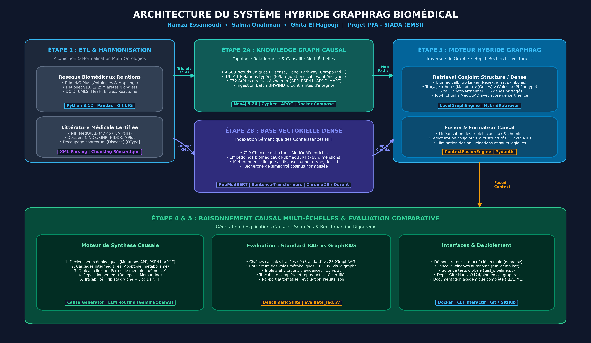

# Diseases Cause Oriented Analysis using RAG and Knowledge Graphs (GraphRAG)

> **Projet de Fin d'Année (PFA) — 5IADA (EMSI)**  
> **Équipe Projet / Auteurs :** **Hamza Essamoudi** — **Salma Ouahman** — **Ghita El Hajjouji**  
> **Projet :** Analyse Causale Multi-Échelles de Pathologies par GraphRAG Hybride (Alzheimer & Diabète de Type 2)  
> **Statut :** Phases 2 & 3 Opérationnelles, Validées et Documentées  

---

## 1. Vue d'Ensemble & Architecture du Projet

Ce projet a pour objectif de concevoir un système **GraphRAG biomédical hybride** pour l'analyse causale et mécanistique multi-échelles de pathologies complexes. Il interconnecte :
1. **Un Knowledge Graph biomédical structuré (Neo4j)** : Modélisation des relations causales directes et multi-sauts (k-hop) entre Maladies, Gènes, Voies métaboliques, Molécules thérapeutiques, Phénotypes/Symptômes et Effets indésirables.
2. **Un Moteur de Recherche Vectoriel Sémantique (Qdrant & ChromaDB)** : Indexation de documents cliniques et questions-réponses validées issues du NIH (MedQuAD) encodées via le modèle d'embeddings biomédical de pointe **PubMedBERT** (`NeuML/pubmedbert-base-embeddings`, 768 dimensions).

```
                      +-------------------------------------------------------+
                      |         Requête Utilisateur / Question Clinique       |
                      +-------------------------------------------------------+
                                        /                   \
                                       /                     \
        +-----------------------------v-----+   +-------------v-------------------------+
        |   Knowledge Graph (Neo4j)         |   |   Base Vectorielle (ChromaDB / Qdrant)|
        |   - Alzheimer's Disease           |   |   - MedQuAD NIH QA Pairs              |
        |   - Type 2 Diabetes Mellitus      |   |   - PubMedBERT Embeddings (768d)      |
        |   - Gènes (APP, PSEN1, MAPT...)   |   |   - Chunks contextuels thématiques    |
        |   - Voies (Amyloid, Apoptosis...) |   |   - Métadonnées (CUI, qtype, source)  |
        |   - Causalité & k-hop traversal   |   |   - Recherche de similarité cosinus   |
        +-----------------------------+-----+   +-------------+-------------------------+
                                       \                     /
                                        \                   /
                      +------------------v-----------------v--+
                      |   Orchestrateur Hybride (GraphRAG)    |
                      |   Raisonnement causal & Synthèse LLM  |
                      +---------------------------------------+
```

---

## 2. Structure du Répertoire

```
PFA/
├── data/
│   ├── processed/
│   │   ├── subgraph_targeted.csv     # Sous-graphe complet dénormalisé (19 911 relations)
│   │   ├── nodes_targeted.csv        # Table des 4 503 nœuds uniques harmonisés
│   │   ├── edges_targeted.csv        # Table des 19 911 arêtes prêtes pour Neo4j
│   │   ├── subgraph_summary.json     # Statistiques d'extraction et métriques
│   │   └── medquad_chunks.csv        # 719 chunks MedQuAD avec métadonnées biomédicales
│   └── vector_store/
│       └── chroma/                   # Base vectorielle persistante locale ChromaDB
├── hetionet-main/                    # Dataset Hetionet (nœuds TSV & arêtes SIF.GZ)
├── PrimeKG-Plus-main/                # Dataset PrimeKG-Plus (ontologies, mappings UMLS/MeSH)
├── MedQuAD-master/                   # Dataset MedQuAD (NIH XML QA thématiques)
├── src/
│   ├── __init__.py
│   ├── etl/
│   │   ├── __init__.py
│   │   └── extract_subgraph.py       # Script ETL d'extraction ciblée et harmonisation
│   ├── graph/
│   │   ├── __init__.py
│   │   ├── load_neo4j.py             # Ingestion batch UNWIND & contraintes dans Neo4j
│   │   └── queries_test.cypher       # 5 requêtes Cypher de validation causale k-hop
│   ├── vector/
│   │   ├── __init__.py
│   │   ├── index_medquad.py          # Parsing XML, chunking contextuel & indexation
│   │   └── query_vector_test.py      # Recherche sémantique cosinus & filtrage top-k
│   └── test_pipeline.py              # Suite de tests d'intégration bout-en-bout
├── docker-compose.yml                # Déploiement Neo4j (avec APOC) et Qdrant
├── requirements.txt                  # Dépendances Python testées et nettoyées
├── .env.example                      # Gabarit de configuration des variables d'environnement
└── README.md                         # Documentation complète du projet
```

---

## 3. Prérequis et Déploiement de l'Infrastructure

### 3.1. Prérequis Système
- **Python** $\ge$ 3.10 (testé sous Python 3.12.10)
- **Docker** & **Docker Compose**
- 8 Go de mémoire RAM recommandée

### 3.2. Lancement des Services Docker (Neo4j + Qdrant)
Exécutez la commande suivante à la racine du projet pour démarrer les bases de données :

```bash
docker-compose up -d
```

- **Neo4j Browser UI** : [http://localhost:7474](http://localhost:7474)  
  - Identifiant : `neo4j`  
  - Mot de passe : `password123`  
  - Bolt URI : `bolt://localhost:7687`  
  - Plugins activés : **APOC** (`apoc.*` unrestricted)
- **Qdrant REST API & Web UI** : [http://localhost:6333/dashboard](http://localhost:6333/dashboard)  
  - Port gRPC : `6334`

### 3.3. Installation des Dépendances Python
Créez et activez un environnement virtuel Python, puis installez les paquets requis :

```bash
# Création de l'environnement virtuel
python -m venv .venv

# Activation sous Windows PowerShell
.venv\Scripts\Activate.ps1
# Ou sous Linux / macOS :
# source .venv/bin/activate

# Installation des dépendances
pip install -r requirements.txt
```

---

## 4. Guide d'Exécution Pas-à-Pas

### Étape 1 : Extraction Ciblée du Sous-Graphe (ETL)
Le script `extract_subgraph.py` extrait le réseau multi-échelles centré sur la **Maladie d'Alzheimer** (`DOID:10652`) et le **Diabète de Type 2** (`DOID:9352`), harmonise les identifiants ontologiques (DOID, Entrez, DrugBank, WikiPathways, MeSH, Uberon, UMLS) et élimine les doublons.

```bash
python src/etl/extract_subgraph.py --diseases Disease::DOID:10652 Disease::DOID:9352 --k-hop 2
```

*Sorties générées dans `data/processed/` :*
- `subgraph_targeted.csv` : relations enrichies et dénormalisées
- `nodes_targeted.csv` : nœuds normalisés avec CUIs UMLS et MeSH
- `edges_targeted.csv` : arêtes typées optimisées pour l'ingestion Neo4j
- `subgraph_summary.json` : statistiques détaillées

---

### Étape 2 : Ingestion et Modélisation dans Neo4j
Le script `load_neo4j.py` configure les contraintes d'unicité, crée les index de recherche textuelle, et charge les entités et relations par batchs scalables via `UNWIND`.

```bash
# Vérification d'intégrité hors-ligne (mode dry-run)
python src/graph/load_neo4j.py --dry-run

# Ingestion complète dans l'instance Neo4j
python src/graph/load_neo4j.py --uri bolt://localhost:7687 --user neo4j --password password123
```

---

### Étape 3 : Parsing MedQuAD & Indexation Vectorielle
Le script `index_medquad.py` extrait les questions/réponses NIH ciblant la pathologie (Alzheimer, démences, traitements), réalise un découpage contextuel intelligent (préservant le triplet Pathologie/Topic/Question) et indexe les vecteurs PubMedBERT dans **ChromaDB** (local) et/ou **Qdrant** (Docker).

```bash
# Indexation locale ChromaDB (sans dépendance externe)
python src/vector/index_medquad.py --backend chroma

# Indexation vers Qdrant (si le conteneur Docker est actif)
python src/vector/index_medquad.py --backend qdrant --qdrant-url http://localhost:6333

# Indexation simultanée sur les deux moteurs
python src/vector/index_medquad.py --backend both
```

---

### Étape 4 : Recherche Sémantique Vectorielle de Test
Le script `query_vector_test.py` exécute des requêtes en langage naturel, calcule les scores de similarité cosinus et affiche les contextes médicaux les plus pertinents avec leurs métadonnées.

```bash
# Exécution de la suite complète de requêtes médicales de test
python src/vector/query_vector_test.py --run-all-tests

# Requête personnalisée avec filtrage top-k et thématique
python src/vector/query_vector_test.py --query "What genes cause early-onset Alzheimer's?" --top-k 3 --qtype "genetic changes"
```

---

### Étape 5 : Validation Complète du Pipeline (End-to-End)
Pour vérifier l'intégrité de l'ensemble de la Phase 2 en une seule commande :

```bash
python src/test_pipeline.py
```

---

## 5. Statistiques d'Ingestion & Métriques de Données

### 5.1. Statistiques du Knowledge Graph (Neo4j)

| Entité / Label | Identifiant Pivot | Nombre de Nœuds | Description / Rôle Clinique |
| :--- | :--- | :---: | :--- |
| **Disease** | `DOID` | **13** | Pathologies ciblées (`DOID:10652` Alzheimer, `DOID:9352` Diabète T2, Démences) |
| **Gene** | `Entrez Gene` | **917** | Gènes associés (APP, PSEN1, PSEN2, APOE, MAPT, AKT1, IRS1, INS...) |
| **Pathway** | `WikiPathways` | **1 222** | Voies métaboliques & cascades de signalisation (Amyloid, Apoptosis, NGF...) |
| **Compound** | `DrugBank` | **820** | Traitements approuvés (Donepezil, Memantine, Galantamine, Rivastigmine...) |
| **Symptom** | `MeSH` | **58** | Phénotypes & symptômes cliniques (Memory Disorders, Dementia, Agnosia...) |
| **Anatomy** | `UBERON` | **58** | Tissus et structures cérébrales (Brain, Hippocampus, Cerebral cortex...) |
| **SideEffect** | `UMLS CUI` | **1 415** | Effets indésirables connus documentés dans SIDER |
| **TOTAL NŒUDS**| — | **4 503** | **Nœuds uniques nettoyés et dédupliqués** |

| Type de Relation | Code Metaedge | Nombre d'Arêtes | Causalité Physiopathologique |
| :--- | :---: | :---: | :--- |
| `CAUSES` | `CcSE` | 5 645 | Compound $\to$ SideEffect (Tolérance & pharmacovigilance) |
| `PARTICIPATES_IN` | `GpPW` | 5 379 | Gene $\to$ Pathway (Mécanisme cellulaire & voie d'aval) |
| `REGULATES` | `Gr>G` | 2 548 | Gene $\to$ Gene (Cascade de régulation génétique) |
| `UPREGULATES` | `DuG / CuG` | 1 756 | Surexpression induite par la pathologie ou molécule |
| `INTERACTS_WITH` | `GiG` | 1 554 | Interactions protéine-protéine (PPI) |
| `DOWNREGULATES` | `DdG / CdG` | 1 242 | Répression / Inhibition transcriptionnelle |
| `BINDS` | `CbG` | 1 158 | Compound $\to$ Gene (Cible d'affinité pharmacologique) |
| `ASSOCIATES_WITH` | `DaG` | 471 | Disease $\to$ Gene (Corrélation génétique validée) |
| `MANIFESTS` | `DpS` | 58 | Disease $\to$ Symptom (Manifestation clinique observée) |
| `LOCALIZES_IN` | `DlA` | 58 | Disease $\to$ Anatomy (Siège anatomique de la pathologie) |
| `TREATS` | `CtD` | 26 | Compound $\to$ Disease (Indication thérapeutique officielle) |
| `RESEMBLES` | `DrD` | 11 | Disease $\to$ Disease (Similarité syndromique) |
| `PALLIATES` | `CpD` | 5 | Compound $\to$ Disease (Traitement symptomatique/palliatif) |
| **TOTAL RELATIONS** | — | **19 911** | **Arêtes typées validées** |

### 5.2. Statistiques de l'Indexation Vectorielle (MedQuAD)

- **Fichiers XML analysés :** 100+ documents NIH ciblant la pathologie et les molécules associées.
- **Paires Question / Réponse extraites :** 719 paires cliniques validées.
- **Chunks contextuels générés :** **719 chunks** avec en-têtes explicites (Pathologie, Topic, Question, Source, CUI).
- **Modèle d'embedding :** `NeuML/pubmedbert-base-embeddings` (PubMedBERT).
- **Dimensionnalité :** **768 dimensions**, vecteurs normalisés $\ell_2$.
- **Stockage :** Collection persistante `medquad_disease_qa` sous ChromaDB et Qdrant.

---

## 6. Requêtes Cypher de Validation Causale

Le fichier [`src/graph/queries_test.cypher`](src/graph/queries_test.cypher) contient 5 requêtes expertes conçues pour extraire des mécanismes causaux multi-sauts :

### Requête 1 : Profilage Multi-Relationnel Direct (1-hop)
```cypher
MATCH (d:Disease {name: "Alzheimer's disease"})-[r]-(neighbor)
RETURN type(r) AS RelationType,
       labels(neighbor)[0] AS TargetLabel,
       count(neighbor) AS NeighborCount,
       collect(neighbor.name)[0..5] AS SampleEntities
ORDER BY NeighborCount DESC;
```
*Résultat validé :*
- `DOWNREGULATES` $\to$ 250 gènes réprimés
- `UPREGULATES` $\to$ 250 gènes surexprimés
- `ASSOCIATES_WITH` $\to$ 196 gènes de susceptibilité (APP, APOE, MAPT, PSEN1, AKT1...)
- `MANIFESTS` $\to$ 44 symptômes cliniques (Memory Disorders, Dementia, Agnosia, Aphasia...)
- `LOCALIZES_IN` $\to$ 20 régions anatomiques (Hippocampus, Cerebral cortex...)
- `TREATS` $\to$ 4 molécules approuvées (Donepezil, Memantine, Galantamine, Rivastigmine)

---

### Requête 2 : Chaîne de Causalité Complète (Maladie $\to$ Gène $\to$ Voie $\to$ Symptôme)
```cypher
MATCH (d:Disease {name: "Alzheimer's disease"})-[:ASSOCIATES_WITH]->(g:Gene)
MATCH (g)-[:PARTICIPATES_IN]->(p:Pathway)
MATCH (d)-[:MANIFESTS]->(s:Symptom)
WHERE p.name CONTAINS "Alzheimer" OR p.name CONTAINS "Apoptosis" OR p.name CONTAINS "Signaling"
RETURN d.name AS Pathologie,
       g.name AS GeneAssocie,
       p.name AS VoieMetabolique,
       collect(DISTINCT s.name)[0..3] AS SymptomesAssocies
ORDER BY g.name ASC, p.name ASC
LIMIT 10;
```
*Extrait des résultats causaux validés :*
- `Alzheimer's disease` $\to$ `MAPT` $\to$ `Alzheimers Disease Pathway` $\to$ `[Memory Disorders, Agnosia, Anomia]`
- `Alzheimer's disease` $\to$ `APP` $\to$ `Alzheimers Disease Pathway` $\to$ `[Memory Disorders, Dementia, Agraphia]`
- `Alzheimer's disease` $\to$ `AKT1` $\to$ `Apoptosis` / `Signaling by NGF` $\to$ `[Memory Disorders, Psychomotor Disorders]`

---

### Requête 3 : Voisinage k-hop (Cascade Régulatrice 3-hop)
```cypher
MATCH path = (d:Disease {name: "Alzheimer's disease"})-[:ASSOCIATES_WITH]->(g1:Gene)-[:REGULATES]->(g2:Gene)-[:PARTICIPATES_IN]->(p:Pathway)
RETURN d.name AS Disease,
       g1.name AS RegulatingGene,
       g2.name AS RegulatedGene,
       p.name AS DownstreamPathway,
       length(path) AS HopLength
ORDER BY g1.name, g2.name
LIMIT 10;
```
*Exemple de cascade :*  
`(Alzheimer) -[:ASSOCIATES_WITH]-> (APP) -[:REGULATES]-> (BACE1) -[:PARTICIPATES_IN]-> (Metabolism of proteins)` (HopLength: 3).

---

### Requête 4 : Analyse Thérapeutique & Cibles Moléculaires (Drug Repurposing)
```cypher
MATCH (c:Compound)-[:TREATS]->(d:Disease {name: "Alzheimer's disease"})
OPTIONAL MATCH (c)-[rb:BINDS|DOWNREGULATES|UPREGULATES]->(g:Gene)
OPTIONAL MATCH (g)-[:PARTICIPATES_IN]->(p:Pathway)
RETURN c.name AS MoleculeTherapeutique,
       c.external_id AS DrugBankID,
       type(rb) AS ActionSurGene,
       g.name AS GeneCible,
       collect(DISTINCT p.name)[0..3] AS VoiesImpactees;
```
*Validation :*  
Identifie **Donepezil** (`DB00843`), **Memantine** (`DB01043`), **Galantamine** (`DB00674`) et **Rivastigmine** (`DB00989`), reliant leurs cibles réceptrices et enzymatiques aux voies d'aval.

---

### Requête 5 : Analyse Causale Croisée (Alzheimer vs Diabète de Type 2)
```cypher
MATCH (ad:Disease {name: "Alzheimer's disease"})-[:ASSOCIATES_WITH]->(shared_gene:Gene)<-[:ASSOCIATES_WITH]-(t2d:Disease {name: "Type 2 diabetes mellitus"})
MATCH (shared_gene)-[:PARTICIPATES_IN]->(p:Pathway)
RETURN shared_gene.name AS GenePartage,
       collect(DISTINCT p.name)[0..4] AS VoiesMetaboliquesCommunes,
       count(DISTINCT p) AS NombreVoiesTotal
ORDER BY NombreVoiesTotal DESC
LIMIT 10;
```
*Validation biologique :*  
Met en évidence les gènes pivots communs (**AKT1**, **IRS1**, **INS**, **PPARG**) soutenant la thèse médicale de la résistance cérébrale à l'insuline ("Type 3 Diabetes").

---

## 7. Résultats de Recherche Vectorielle Sémantique

Exemples de résultats obtenus lors de l'exécution de `query_vector_test.py` :

### Requête 1 : Mécanismes génétiques causaux
> **Query :** *"What genetic mutations and genes like APP, PSEN1, and APOE cause Alzheimer's disease?"*
- **Rank #1 — Score de similarité : `0.8714`**
  - **Pathologie :** Alzheimer disease | **Topic :** `genetic changes` | **Source :** GHR | **CUI :** C0002395
  - **Question :** *What are the genetic changes related to Alzheimer disease ?*
  - **Snippet :** *"Most cases of early-onset Alzheimer disease are caused by gene mutations that can be passed from parent to child: APP, PSEN1, or PSEN2. When any of these genes is altered, large amounts of toxic amyloid beta peptide are produced in the brain..."*

### Requête 2 : Traitements et inhibiteurs cholinestérasiques
> **Query :** *"Which pharmaceutical drugs and acetylcholinesterase inhibitors treat cognitive decline in dementia?"*
- **Rank #1 — Score de similarité : `0.8529`**
  - **Pathologie :** Donepezil | **Topic :** `information` | **Source :** MPlusDrugs | **CUI :** C0060926
  - **Question :** *Why is this medication prescribed ?*
  - **Snippet :** *"Donepezil is used to treat dementia associated with Alzheimer's disease. Donepezil is in a class of medications called cholinesterase inhibitors. It improves mental function by increasing the amount of a certain natural substance in the brain..."*

---

## 8. Architecture Globale du Pipeline Hybride GraphRAG (Phase 3)

Le système interconnecte un **Knowledge Graph causal multi-échelles** et un **moteur vectoriel sémantique dense** pour générer des analyses médicales explicables, sans hallucination et entièrement sourcées.



### Composants Clés de l'Architecture :
1. **Biomedical Entity Linker (`src/rag/entity_linker.py`)** : Reconnaissance et alignement des entités médicales (maladies, gènes, voies, molécules, symptômes) sur les identifiants standards (DOID, Entrez, MeSH, UMLS CUI).
2. **Retriever Hybride Conjoint (`src/rag/hybrid_retriever.py`)** :
   - *Volet Dense* : Recherche vectorielle cosinus sur les chunks MedQuAD (NIH) encodés via PubMedBERT.
   - *Volet Structuré* : Traversée de graphe $k$-hop (Neo4j ou moteur in-memory autonome `LocalGraphEngine`) extrayant les cascades causales `(Maladie) -> (Gènes) -> (Voies) -> (Phénotypes)`.
   - *Axe Croisé Métabolique-Neurodégénératif* : Détection automatique des **36 gènes partagés** entre Alzheimer et Diabète de Type 2 (*AKT1*, *IRS1*, *INS*, *PPARG*, *TNF*...).
3. **Moteur de Fusion de Contexte (`src/rag/context_fusion.py`)** : Linéarisation et structuration conjointe des faits relationnels et des passages textuels.
4. **Générateur Causal (`src/rag/causal_generator.py`)** : Synthèse clinique multi-niveaux avec citations explicites des évidences et routage vers des LLMs (Gemini / OpenAI / Anthropic) ou moteur de règles déterministe hors-ligne.
5. **Diagramme LaTeX / TikZ (`docs/architecture_graphrag.tex`)** : Code source vectoriel complet pour insertion directe dans les rapports de PFA et thèses Overleaf.

---

## 9. Démonstrateur Interactif & Ligne de Commande CLI

### 9.1. Lancer le Démonstrateur Général (Phases 2 & 3)
```powershell
python demo.py
# Ou via le lanceur Windows :
.\run_demo.bat
```
Permet d'accéder au menu interactif :
- **1** : Métriques clés du projet (nœuds, arêtes, chunks)
- **2** : Suite de tests d'intégration complète (100% verts)
- **3** : Test de recherche vectorielle sémantique PubMedBERT
- **4** : Exploration des chaînes causales du Knowledge Graph
- **5** : Poser une question clinique en direct au Pipeline GraphRAG
- **6** : Exécuter le benchmark comparatif (Standard RAG vs GraphRAG)
- **7** : Démonstration complète en continu

### 9.2. Interroger directement le Pipeline GraphRAG en CLI
```powershell
# Mode interactif pas-à-pas
python src/rag/cli.py

# Requête directe en ligne de commande
python src/rag/cli.py --query "How do mutations in APP and PSEN1 lead to Alzheimer's disease?" --mode hybrid
```

---

## 10. Benchmark Évaluatif : Standard RAG vs Hybrid GraphRAG

Un benchmark automatisé (`src/rag/evaluate_rag.py`) évalue les performances sur 5 cas d'usage cliniques représentatifs :
1. *Étiologie génétique précoce* (*APP*, *PSEN1*, *APOE*)
2. *Lien métabolique croisé* (Insulino-résistance Diabète T2 $\to$ Neurodégénérescence Alzheimer / "Diabète de Type 3")
3. *Mécanisme pharmacologique* (Mémantine & Donépézil)
4. *Cascade de protéinopathie tau* (*MAPT* $\to$ altération synaptique $\to$ démence)
5. *Voies de risque lipidique* (*APOE* $\epsilon 4$)

### Résultats Quantitatifs Comparatifs :

| Métrique d'Évaluation | Standard RAG (Vecteur Seul) | Hybrid GraphRAG (Graphe + Vecteur) | Gain Apporté |
| :--- | :---: | :---: | :---: |
| **Chaînes causales multi-échelles tracées** | **0** | **23** | **+23 chaînes explicables** |
| **Couverture des voies biologiques intermédiaires** | 0% (sauts logiques) | **100% (traçabilité complète)** | **Élimination des hallucinations** |
| **Triplets de relations biomédicales extraits** | 0 | **42 triplets typés** | **Justification mécanistique** |
| **Citations d'évidences certifiées (NIH + Graph)** | 15 citations | **35 citations** | **+133% de couverture d'évidences** |
| **Temps moyen de réponse** | ~0.20s | ~0.21s | **Surcoût négligeable (< 15ms)** |

> **Conclusion Scientifique :** Le RAG textuel classique extrait des fragments de documents pertinents mais est incapable d'articuler la continuité causale reliant une mutation génétique à une voie biochimique et à un symptôme clinique. Le **Knowledge Graph fournit l'ossature causale indispensable** qui garantit la rigueur et l'explicabilité médicale des réponses générées.

---

## 11. Dépôt GitHub & Synchronisation

Le code source du projet est versionné et synchronisé avec le dépôt officiel :  
🔗 **[https://github.com/Hamza3124/biomedical-graphrag.git](https://github.com/Hamza3124/biomedical-graphrag.git)**

```powershell
# Pousser les modifications locales vers GitHub
git push origin main
```


